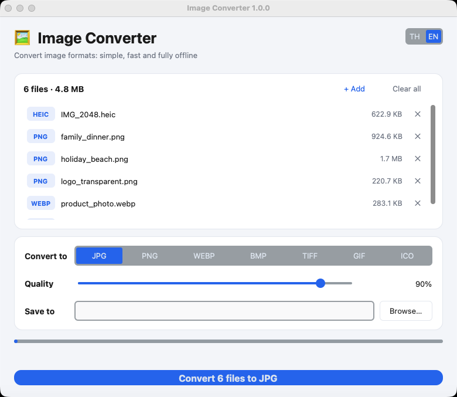

<div align="center">


# Image Converter

**Convert images between PNG, JPG, WEBP, BMP, TIFF, GIF and ICO: simple, fast, offline.**

[](https://github.com/madara1150/image-converter/releases/latest)
[](https://github.com/madara1150/image-converter/releases)


**English** · [ภาษาไทย](README.th.md)

<picture>
  <source media="(prefers-color-scheme: dark)" srcset="docs/screenshot-dark.png">
  
</picture>

</div>

## ⬇️ Download

<div align="center">

[](https://github.com/madara1150/image-converter/releases/latest/download/ImageConverter-Windows.zip)
[](https://github.com/madara1150/image-converter/releases/latest/download/ImageConverter-macOS-AppleSilicon.zip)
[](https://github.com/madara1150/image-converter/releases/latest/download/ImageConverter-macOS-Intel.zip)

</div>

| System | How to open |
|---|---|
| **Windows** | Unzip, open the `ImageConverter` folder, run `ImageConverter.exe`. Keep the whole folder together. |
| **macOS** | Unzip and move `ImageConverter.app` to Applications. On first launch, if macOS blocks it, go to **System Settings → Privacy & Security → Open Anyway**. |

> Not sure which Mac you have?  → About This Mac. "Apple M1/M2/M3/M4…" = Apple Silicon, "Intel" = Intel.

## ✨ Features

- **Input:** PNG, JPG/JPEG, WEBP, BMP, TIFF, GIF, ICO, HEIC (iPhone photos)
- **Output:** JPG, PNG, WEBP, BMP, TIFF, GIF, ICO
- 🖱️ Drag & drop files or folders straight into the window
- 📂 Convert many files or whole folders (including subfolders) at once
- 🎚️ Adjustable quality for JPG / WEBP
- ⬜ Transparent images get a white background when saved as JPG / BMP
- 📷 Keeps EXIF data and color profiles
- 🛡️ Never overwrites your files: duplicates are saved as `name_1.jpg`
- 🌗 Light & dark mode, Thai & English interface
- 🔒 Works 100% offline: no internet, no tracking

## 🚀 Usage

1. Drag images into the window, or click **Choose files** / **Choose folder**
2. Choose the output format and quality
3. Pick an output folder (leave empty to save next to the originals)
4. Click **Convert** and then **Open folder** to see the results

### Command line

```bash
pip install -r requirements.txt
python image_converter.py                          # open the GUI
python image_converter.py photo.png --to jpg --quality 90
python image_converter.py ./pictures --to webp --out ./output
```

## 🛠️ Build from source

| System | Command | Output |
|---|---|---|
| Windows | double-click `build_windows.bat` | `dist\ImageConverter\ImageConverter.exe` |
| macOS | `./build_mac.sh` (needs Python with Tk 8.6+, e.g. `brew install python python-tk`) | `dist/ImageConverter.app` |

Releases are built automatically by GitHub Actions when a `v*` tag is pushed.

## 🛡️ About antivirus warnings

Apps packaged with PyInstaller are sometimes flagged by mistake (false positives). This project reduces that risk by:

1. Building in **`--onedir`** mode (no self-extracting to a temp folder at launch)
2. **Not using UPX** compression, a common cause of false positives
3. Embedding **publisher and version info** in the `.exe`
4. Ad-hoc **code signing** on macOS

The code does not use the network, touch the registry, or launch other programs. If your antivirus still flags it, you can check the file on [VirusTotal](https://www.virustotal.com) or report it to [Microsoft](https://www.microsoft.com/wdsi/filesubmission) as a false positive.

## 📄 License

Free for personal use.
