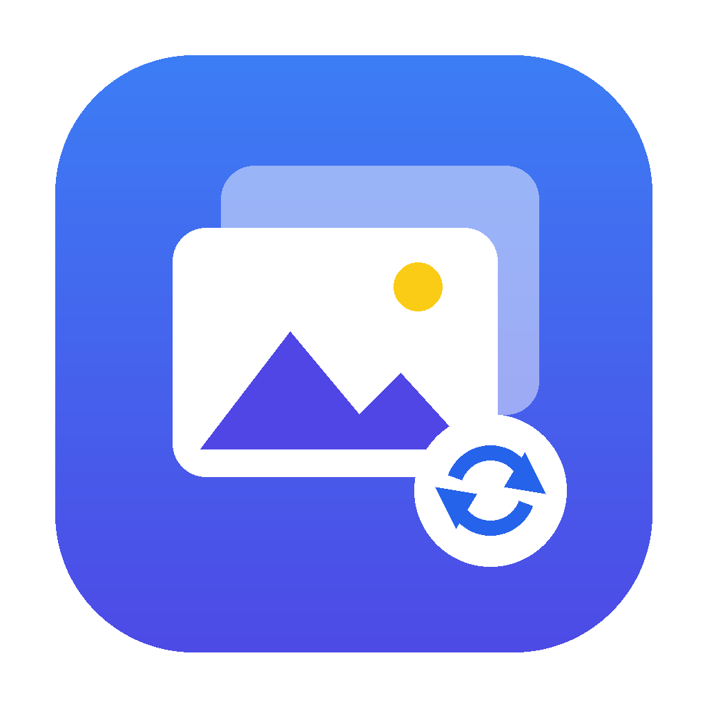
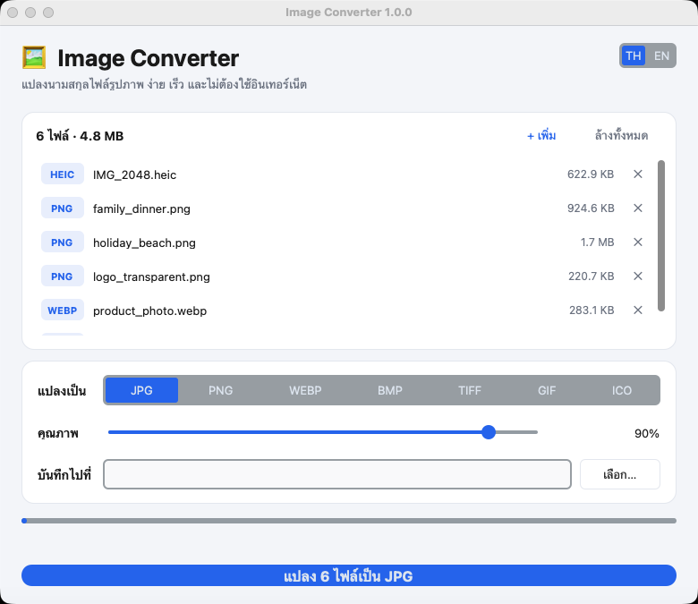

<div align="center">



# Image Converter

**โปรแกรมแปลงนามสกุลไฟล์รูป PNG, JPG, WEBP, BMP, TIFF, GIF, ICO ใช้ง่าย เร็ว ไม่ต้องใช้อินเทอร์เน็ต**

[](https://github.com/madara1150/image-converter/releases/latest)
[](https://github.com/madara1150/image-converter/releases)


[English](README.md) · **ภาษาไทย**



</div>

## ⬇️ ดาวน์โหลด

<div align="center">

[](https://github.com/madara1150/image-converter/releases/latest/download/ImageConverter-Windows.zip)
[](https://github.com/madara1150/image-converter/releases/latest/download/ImageConverter-macOS-AppleSilicon.zip)
[](https://github.com/madara1150/image-converter/releases/latest/download/ImageConverter-macOS-Intel.zip)

</div>

| ระบบ | วิธีเปิด |
|---|---|
| **Windows** | แตกไฟล์ zip เปิดโฟลเดอร์ `ImageConverter` แล้วดับเบิลคลิก `ImageConverter.exe` (ห้ามแยกไฟล์ .exe ออกจากโฟลเดอร์) |
| **macOS** | แตกไฟล์ zip แล้วลาก `ImageConverter.app` ไปไว้ใน Applications ถ้าเปิดครั้งแรกแล้ว macOS ไม่ยอมให้เปิด ให้ไปที่ **System Settings → Privacy & Security → Open Anyway** |

> ไม่แน่ใจว่า Mac ของคุณเป็นรุ่นไหน? กด  → About This Mac ถ้าขึ้น "Apple M1/M2/M3/M4…" ให้โหลด Apple Silicon ถ้าขึ้น "Intel" ให้โหลด Intel

## ✨ ความสามารถ

- **อ่านไฟล์ได้:** PNG, JPG/JPEG, WEBP, BMP, TIFF, GIF, ICO, HEIC (รูปจาก iPhone)
- **แปลงเป็น:** JPG, PNG, WEBP, BMP, TIFF, GIF, ICO
- 🖱️ ลากไฟล์หรือโฟลเดอร์มาวางในหน้าต่างได้เลย
- 📂 แปลงหลายไฟล์พร้อมกัน หรือทั้งโฟลเดอร์ (รวมโฟลเดอร์ย่อย)
- 🎚️ ปรับคุณภาพ JPG / WEBP ได้
- ⬜ รูปพื้นโปร่งใส ถ้าแปลงเป็น JPG / BMP จะใส่พื้นหลังสีขาวให้
- 📷 เก็บข้อมูล EXIF และ color profile ไว้ครบ
- 🛡️ ไม่เขียนทับไฟล์เดิม ถ้าชื่อซ้ำจะบันทึกเป็น `ชื่อ_1.jpg`
- 🌗 รองรับโหมดสว่าง/มืด และสลับภาษาไทย/อังกฤษได้
- 🔒 ทำงานแบบออฟไลน์ 100% ไม่ส่งข้อมูลไปไหน

## 🚀 วิธีใช้

1. ลากรูปมาวางในหน้าต่าง หรือกด **เลือกไฟล์** / **เลือกโฟลเดอร์**
2. เลือกนามสกุลที่จะแปลง และคุณภาพ
3. เลือกโฟลเดอร์ปลายทาง (เว้นว่าง = บันทึกไว้ที่เดียวกับไฟล์ต้นฉบับ)
4. กด **แปลง** แล้วกด **เปิดโฟลเดอร์** เพื่อดูไฟล์ที่ได้

### ใช้ผ่าน command line

```bash
pip install -r requirements.txt
python image_converter.py                          # เปิดหน้าจอ GUI
python image_converter.py รูป.png --to jpg --quality 90
python image_converter.py ./โฟลเดอร์รูป --to webp --out ./output
```

## 🛠️ Build จากซอร์สโค้ด

| ระบบ | คำสั่ง | ได้ไฟล์ |
|---|---|---|
| Windows | ดับเบิลคลิก `build_windows.bat` | `dist\ImageConverter\ImageConverter.exe` |
| macOS | `./build_mac.sh` (ต้องใช้ Python ที่มี Tk 8.6 ขึ้นไป เช่น `brew install python python-tk`) | `dist/ImageConverter.app` |

ไฟล์ดาวน์โหลดใน Releases สร้างอัตโนมัติด้วย GitHub Actions ทุกครั้งที่ push tag `v*`

## 🛡️ เรื่อง antivirus แจ้งเตือน

โปรแกรมที่ทำด้วย PyInstaller บางครั้งถูก antivirus แจ้งเตือนผิด (false positive) โปรเจกต์นี้ลดโอกาสนั้นด้วยการ

1. build แบบ **`--onedir`** (ไม่แตกไฟล์ลงโฟลเดอร์ temp ตอนเปิดโปรแกรม)
2. **ไม่บีบอัดด้วย UPX** ซึ่งเป็นสาเหตุหลักของการแจ้งเตือนผิด
3. ฝัง **ข้อมูลผู้ผลิตและเวอร์ชัน** ไว้ในไฟล์ `.exe`
4. **เซ็นโค้ดแบบ ad-hoc** บน macOS

ตัวโปรแกรมไม่ใช้อินเทอร์เน็ต ไม่แก้ registry และไม่เรียกโปรแกรมอื่น ถ้ายังถูกแจ้งเตือน ตรวจไฟล์ได้ที่ [VirusTotal](https://www.virustotal.com) หรือแจ้ง [Microsoft](https://www.microsoft.com/wdsi/filesubmission) ว่าเป็นการแจ้งเตือนผิด

## 📄 License

ใช้งานส่วนตัวได้ฟรี
